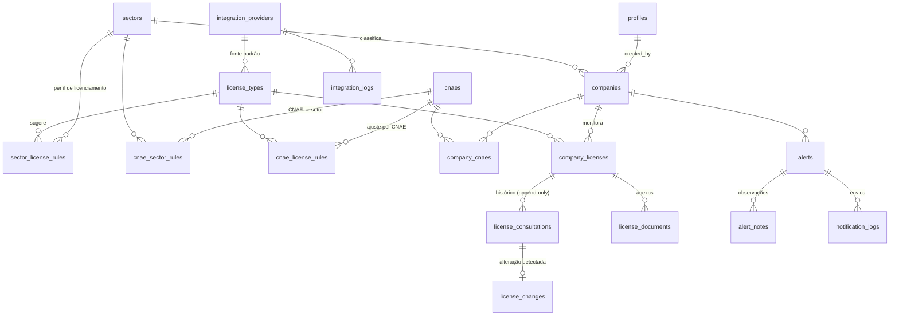

# Alexandre Alvarás — Monitor de Licenças & Alvarás

Documento de arquitetura (Etapa 1). Referência visual oficial: [`docs/referencia/layout-aprovado.png`](referencia/layout-aprovado.png).

---

## 1. Análise da imagem de referência

### 1.1 Estrutura (desktop 1536 × 1024)

| Região | Conteúdo | Observações de fidelidade |
|---|---|---|
| Menu lateral (204 px) | Logo **JR SISTEMA**, Dashboard (ativo), Empresas, Monitor de Licenças (expansível com 5 setores), Histórico de Consultas, Alertas, Relatórios, Configurações, mascote JR com balão | Fundo `#0B2340`, item ativo em pílula `#124890`, ícones sólidos brancos |
| Cabeçalho | Título "Monitor de Licenças & Alvarás", subtítulo, busca global, sino com contador, avatar + nome + perfil + menu | Busca à direita (≈300 px), contador vermelho no sino |
| KPIs (5 cards) | Empresas monitoradas · Licenças vencidas · Vencem em até 30 dias · Vencem em até 60 dias · Totalmente regulares | Ícone em quadrado suave, número grande colorido |
| Setores (5 cards) | Banner (cor do setor + ícone em círculo + foto), nome, total, vencidas/atenção/regulares, botão "Ver empresas →" | Card selecionado ganha borda na cor do setor |
| Painel do setor (≈57%) | Título do setor, total cadastrado, busca, **+ Nova Empresa**, filtros em pílula, tabela, paginação | 4 colunas de licença por ícone, status em badge, ação "olho", 10 por página |
| Painel da empresa (≈43%) | Cabeçalho (razão social, CNPJ, setor, município, endereço, badge ATIVA, foto), abas, índice de regularidade, última verificação, tabela de licenças, histórico de consultas | Aba ativa sublinhada em azul; botão "Consultar" suave por licença |

### 1.2 Paleta extraída da imagem

| Uso | Cor |
|---|---|
| Menu lateral | `#0B2340` (ativo `#124890`) |
| Fundo da área principal | `#E9F1FB` |
| Títulos | `#0A1A33` |
| Azul primário (botões, paginação) | `#0C6CF0` · pílula ativa `#0C60C0` |
| Setores | Laranja `#F06A1E` · Verde `#129C5A` · Roxo `#7250A8` · Azul `#126CD8` · Rosa `#F0247E` |
| Situação | Regular `#08A050` · Atenção `#F08A06` · Vencida `#F00C1E` · Não aplicável `#9AA3AF` |
| Badges | Regular `#D4F1E4` · Atenção `#FCEFC2` · Pendência `#FCC8D2` |

Tipografia: **Roboto** (auto-hospedada, funciona offline/PWA).

### 1.3 Leituras da referência que viram regra de negócio

1. **Fonte × status calculado.** Bombeiros aparece "Regular" no histórico (o que o órgão informou), mas "Atenção" na tabela de licenças (vence em 24 dias). O modelo separa **situação informada pela fonte** (`situation`) do **status calculado** pelo sistema (vencimento + aplicabilidade).
2. **Índice de 85%.** 2 licenças regulares (100) + 1 em atenção de 16–30 dias (55) ÷ 3 aplicáveis = 85%. Licença Ambiental "Não aplicável" fica fora do cálculo. Os pesos ficam em configuração.
3. **Cards de setor contam empresas**, KPIs contam licenças (exceto "Empresas monitoradas" e "Totalmente regulares").
4. **Inconsistências da imagem** (mockup estático): KPI "41 totalmente regulares" ≠ soma dos setores (37); "4 licenças vencidas" coexistem com 6 empresas em pendência (há licenças *pendentes*, não só vencidas). Como os números agora são calculados, os dados de demonstração reproduzem **exatamente os cards de setor e a tabela** e os KPIs saem consistentes com eles (37 regulares, 4 vencidas, 7 em 30 dias, 12 em 60 dias).

### 1.4 Itens pedidos que não aparecem na imagem

Para não alterar o layout aprovado, entram **fora da área visível da referência**:

- **"Atenção hoje"**: seção logo abaixo dos dois painéis do Dashboard (aparece rolando a página).
- Login, Empresas, Histórico, Alertas, Relatórios e Configurações: páginas próprias, usando os mesmos componentes (cards, tabelas, badges) da referência.

---

## 2. Projeto atual e reaproveitamento

A pasta continha apenas a imagem; **não havia código a reaproveitar**. Reaproveitamento visual:

- Recortes da própria referência viraram **imagens provisórias**: fotos dos banners dos setores, foto da padaria, mascote JR (`public/`).
- A logo **JR SISTEMA** foi recriada em CSS, sem redesenho; o componente `BrandLogo` aceita o arquivo oficial assim que existir (`src/config/brand.ts`).

---

## 3. Arquitetura

```
┌───────────────────────────── UI (React + Tailwind) ─────────────────────────────┐
│ pages/  →  features/* (dashboard, sectors, companies, licenses, consultations,   │
│            alerts, reports, settings)  →  components/ui (Card, Badge, Table…)    │
└───────────────┬─────────────────────────────────────────────────────────────────┘
                │ hooks (TanStack Query: cache, loading, erro)
┌───────────────▼──────────────┐     ┌──────────────────────────────────────────┐
│ services/ (casos de uso)     │────▶│ domain/ (regras puras, sem React/Supabase)│
│ registrar consulta, cadastrar│     │ status, vencimento, índice, alterações,   │
│ empresa, rotina de monitor.  │     │ métricas, alertas, CNPJ, permissões       │
└───────┬──────────────┬───────┘     └──────────────────────────────────────────┘
        │              │
┌───────▼──────┐ ┌─────▼──────────────────────────────────────────────┐
│ data/        │ │ integrations/                                      │
│ DataSource   │ │ LicenseProvider (1 adapter por órgão)              │
│ ├─ mock      │ │ CnpjLookupProvider · NotificationChannel           │
│ └─ supabase  │ │ (hoje: todos "INTEGRAÇÃO PENDENTE")                │
└──────────────┘ └────────────────────────────────────────────────────┘
```

Decisões:

- **`domain/` é TypeScript puro e testado** (Vitest). Pode ser importado por Edge Functions no futuro, evitando duplicar regras.
- **`DataSource` com duas implementações.** Sem `.env` do Supabase, o app roda em **modo demonstração** (dados fictícios no `localStorage`). Com `VITE_SUPABASE_URL` e `VITE_SUPABASE_ANON_KEY`, usa o Supabase. As telas não sabem qual está ativo.
- **Gravação de consulta atômica.** O serviço compara com a última consulta (domínio) e a persistência acontece numa única transação (`record_consultation` no Postgres), com checagem de concorrência: se outra consulta entrou no meio, nada é gravado.
- **Integrações nunca rodam no navegador.** Adapters reais ficarão em Edge Functions (credenciais no servidor). O navegador só conhece a interface. Nenhuma API foi inventada; todos os provedores estão como `pendente`.
- **Configurações em banco** (`system_settings`): faixas de vencimento, pesos do índice, agenda de notificações.

---

## 4. Estrutura de pastas

```
├── docs/                     arquitetura + imagem de referência
├── public/                   imagens provisórias, ícones PWA, manifest
├── supabase/
│   ├── migrations/           schema, RLS, auditoria, funções, storage
│   ├── seed.sql              catálogo inicial (setores, licenças, CNAEs, provedores)
│   └── functions/            Edge Function monitor-licenses (rotina diária)
├── scripts/                  validação do banco (PGlite), seed, capturas, imagens provisórias
└── src/
    ├── app/                  App, rotas, providers, layout de página
    ├── config/               marca, env, tema dos setores, navegação
    ├── domain/               regras de negócio puras (+ testes)
    ├── data/
    │   ├── types.ts          contratos dos repositórios (DataSource)
    │   ├── mock/             banco em memória/localStorage + seed de demonstração
    │   └── supabase/         client, mapeadores, implementação
    ├── integrations/
    │   ├── licensing/        LicenseProvider, registry, provedores pendentes
    │   ├── cnpj/             preenchimento por CNPJ (manual/mock)
    │   └── notifications/    canais (interno, e-mail/Resend, WhatsApp futuro) + templates
    ├── services/             casos de uso (consulta, empresa, rotina, relatórios)
    ├── server/               ponto de entrada da rotina no servidor (empacotado p/ Edge Function)
    ├── hooks/                hooks de dados (React Query)
    ├── components/
    │   ├── ui/               primitivos reutilizáveis
    │   ├── layout/           Sidebar, Topbar, busca global, sino, menu do usuário
    │   └── brand/            BrandLogo, Mascot (substituíveis)
    ├── features/             telas por domínio
    └── lib/                  utilitários (datas, classes)
```

---

## 5. Modelo de dados (Supabase / PostgreSQL)

Todas as tabelas usam `uuid`, `created_at`, `updated_at` e, quando faz sentido, `created_by`/`updated_by`.



| Tabela | Papel | Pontos-chave |
|---|---|---|
| `profiles` | usuários (estende `auth.users`) | `role`: administrador · contador · colaborador · consulta. Novo usuário entra como `consulta` |
| `sectors` | setores | cor, ícone, banner, ordem |
| `cnaes`, `company_cnaes` | CNAE principal e secundários | um único principal por empresa (índice parcial) |
| `cnae_sector_rules` | matriz CNAE → setor | prioridade; sempre sugestão |
| `license_types` | catálogo de licenças | órgão, esfera (municipal/estadual…), fonte padrão, tem validade? |
| `sector_license_rules` | perfil de licenciamento do setor | aplicabilidade **sugerida**, coluna na tabela do setor |
| `cnae_license_rules` | ajuste fino por CNAE | ex.: veterinária → CRMV aplicável |
| `companies` | cadastro | CNPJ único (aceita CNPJ alfanumérico), status ATIVA/INATIVA/EM IMPLANTAÇÃO |
| `company_licenses` | licença monitorada da empresa | aplicabilidade, situação atual, validade, nº documento/protocolo, fonte |
| `license_consultations` | **histórico imutável** | toda consulta gera linha nova; UPDATE/DELETE bloqueados por trigger |
| `license_changes` | alterações detectadas | diff campo a campo (anterior × atual) |
| `license_documents` | documentos anexados | arquivo no Storage privado; arquivamento lógico |
| `alerts`, `alert_notes` | central de alertas | categoria, prioridade, lido/resolvido, `dedupe_key` |
| `notification_templates`, `notification_logs` | notificações | 90/60/30/15/7 dias e vencida; canais interno/e-mail/WhatsApp |
| `integration_providers`, `integration_logs` | integrações | status `pendente` até existir integração oficial |
| `system_settings` | configurações | faixas, pesos, agenda |
| `audit_logs` | auditoria | usuário, ação, empresa, registro, antes/depois, origem |

Exclusões: histórico, alterações, documentos, alertas e auditoria usam `ON DELETE RESTRICT`. Uma empresa com histórico **não pode ser apagada**, só inativada.

---

## 6. Regras de negócio (em `src/domain`)

**Status da licença** (`resolveLicenseStatus`):

1. Aplicabilidade `nao_aplicavel` / `dispensada` / `em_analise` → esse é o status.
2. Situação informada `vencida`, `pendente`, `em_renovacao`, `em_analise` → esse é o status.
3. Situação `regular` (ou sem situação mas com validade) → faixa de vencimento:

| Dias até vencer | Faixa | Status |
|---|---|---|
| > 60 | regular | Regular |
| 31 – 60 | atenção preventiva | Atenção |
| 16 – 30 | atenção | Atenção |
| 8 – 15 | atenção alta | Atenção |
| 0 – 7 | crítico | Atenção (crítico) |
| < 0 | vencida | Vencida |

Sem consulta e sem validade → **Pendente**. As faixas ficam em `system_settings.expiration_thresholds`.

**Situação da empresa** (badge da tabela): alguma licença vencida/pendente → **Pendência**; senão alguma em atenção/renovação/análise → **Atenção**; senão **Regular**.

**Índice de regularidade**: média ponderada só das licenças `aplicavel`. Pesos padrão: regular 100 · preventiva 80 · atenção 55 · alta 40 · crítico 25 · em renovação 50 · vencida/pendente 0.

**Detecção de alteração**: compara a nova consulta com a última consulta bem-sucedida da mesma licença (situação, validade, emissão, nº documento, protocolo). Campo não informado na nova consulta não conta como alteração. Gera `license_changes` + alerta "Alteração detectada".

**KPIs**: empresas monitoradas = ativas + em implantação; licenças vencidas, vencendo em ≤ 30 e em ≤ 60 dias (cumulativo) contam só licenças aplicáveis de empresas monitoradas; totalmente regulares = empresas com situação Regular.

---

## 7. Fluxo das páginas

```
/login (só com Supabase)
/                         Dashboard = cabeçalho + KPIs + setores + painel do setor + painel da empresa
  └─ "Ver empresas"       seleciona o setor no painel inferior (?setor=)
  └─ clique na empresa    abre o perfil no painel direito (?empresa=)
  └─ "Atenção hoje"       abaixo dos painéis
/monitor/:setor           mesma composição (setor + empresa), em página dedicada (submenu)
/empresas                 todas as empresas, filtros, + Nova Empresa
/empresas/nova            cadastro (CNPJ → sugestão de setor → licenças sugeridas)
/empresas/:id             perfil completo (Resumo · Documentos · Histórico · Observações · Editar)
/historico                histórico global de consultas (filtros, tipo manual/automática)
/alertas                  central de alertas (lido, resolver, observação, abrir empresa/licença)
/relatorios               relatórios + exportação CSV (PDF/Excel preparados)
/configuracoes            vencimentos, índice, licenças × setores, CNAEs, integrações,
                          notificações, usuários, auditoria, rotina automática
```

Fluxo de consulta: **Consultar** → provedor do órgão → (integração pendente) → formulário **Registrar consulta** → grava histórico → compara com a anterior → atualiza licença → gera alerta se mudou.

---

## 8. Segurança

| Ação | Administrador | Contador | Colaborador | Consulta |
|---|:-:|:-:|:-:|:-:|
| Ver dados | ✔ | ✔ | ✔ | ✔ |
| Cadastrar/editar empresas e licenças | ✔ | ✔ | ✔ | — |
| Registrar consulta, anexar documento, tratar alertas | ✔ | ✔ | ✔ | — |
| Excluir empresa sem histórico | ✔ | — | — | — |
| Configurações, catálogo, matriz CNAE/setor, integrações, usuários | ✔ | — | — | — |
| Ver auditoria | ✔ | ✔ | — | — |

- RLS em todas as tabelas; funções `current_role()` / `has_role()`.
- Usuário não altera o próprio perfil de acesso (trigger).
- Auditoria por trigger nas tabelas críticas, com origem (`app`, `rotina`, `integracao`, `sistema`).
- Somente a `anon key` vai para o navegador; `service_role` apenas em Edge Functions.

---

## 9. Fases — situação desta entrega

| Fase | Escopo | Situação |
|---|---|---|
| 1 | Estrutura visual fiel | ✅ Dashboard conferido contra a referência em 1536 × 1024 (capturas lado a lado) |
| 2 | Supabase e banco | ✅ 5 migrations + seed + RLS + auditoria, validados em PostgreSQL (PGlite, `npm run db:validate`); DataSource Supabase implementado — **falta testar contra um projeto Supabase real** |
| 3 | Cadastro de empresas | ✅ Cadastro/edição/exclusão (só sem histórico), CNPJ numérico e alfanumérico, CNAEs; preenchimento por CNPJ simulado no modo demo |
| 4 | Setores | ✅ Cards, página por setor, matriz CNAE → setor → licenças editável |
| 5 | Licenças | ✅ Aplicabilidade, status calculado, faixas e pesos configuráveis; catálogo editável em *Configurações → Tipos de licença* (inclui Licença de Acessibilidade) |
| 6 | Histórico de consultas | ✅ Registro manual, histórico imutável, detecção de alteração, linha do tempo, página global |
| 7 | Alertas e vencimentos | ✅ Central de alertas, "Atenção hoje", sino, rotina simulável na tela e empacotada para Edge Function |
| 8 | Documentos | ✅ Anexos por licença (Storage privado; no modo demo, até 750 KB), arquivamento lógico |
| 9 | Relatórios | ✅ 9 relatórios + exportação CSV; PDF/Excel com botões preparados (desativados) |
| 10 | Integrações externas | 🟡 Somente arquitetura: interface `LicenseProvider`, registry, status por fonte. Todas "INTEGRAÇÃO PENDENTE" |

### Verificações feitas

- 57 testes automatizados (regras de negócio, dados de demonstração, serviços e tela de tipos de licença) — `npm test`.
- 27 verificações do banco (RLS por perfil, histórico imutável, concorrência, deduplicação de alertas, auditoria, busca, bloqueio de exclusão) — `npm run db:validate`.
- Fluxos testados na interface real: Consultar → INTEGRAÇÃO PENDENTE → registrar consulta → "Alteração detectada" (ANTERIOR × ATUAL) → status, histórico e índice atualizados; cadastro com sugestão de setor/licenças pelo CNAE; marcar alerta como lido.
- Responsividade: 1536 (referência), 1366 (notebook), 390 (celular, sem rolagem horizontal da página).

### Adaptações em relação à imagem (só onde foi necessário)

- **KPI "Totalmente regulares" mostra 37**, não 41: o número agora é calculado e precisa bater com a soma dos cards de setor (9 + 10 + 6 + 2 + 10).
- **Abaixo de 1440 px** de largura (ex.: notebook 1366), o painel da empresa vai para baixo da tabela do setor, em vez de ao lado. Lado a lado, a tabela ficaria espremida ou com fonte ilegível.
- **"Atenção hoje"** fica abaixo dos dois painéis do Dashboard, fora da área visível da referência.
- Celular: menu lateral vira gaveta (☰) e a tabela do setor vira lista de cartões.

### Acréscimo: Simulação de Licenciamento

Funcionalidade adicionada depois da primeira entrega, sem alterar as telas existentes. Motor de regras em `src/domain/simulation`, banco na migration `20261004000600_simulation.sql`. Ver [SIMULACAO.md](SIMULACAO.md).

## 10. Pontos para decisão

1. **Marca**: a imagem mostra "JR SISTEMA"; o pedido cita "ALEXANDRE ALVARÁS". A tela segue a imagem; o nome do produto fica em `src/config/brand.ts` (título da aba e PWA).
2. **Arquivos oficiais** da logo, do mascote e das fotos dos setores substituem os recortes provisórios em `public/`.
3. **Projeto Supabase**: URL e anon key para sair do modo demonstração e validar a Fase 2 contra o servidor real.
4. **Destinatários dos e-mails** de vencimento e domínio verificado no Resend.
